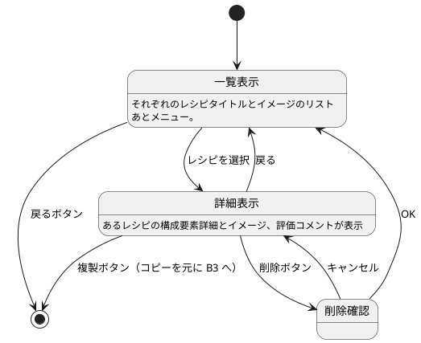

# B1 レシピノート（Recipe Note）

## 概要
プレイヤーが既存レシピを確認したり、新しいレシピを作成・保存するためのシーン。
ラーメン屋のメモ帳をイメージにデザインする

## 機能一覧

| 項目              | 内容                                               |
|-------------------|----------------------------------------------------|
| レシピ一覧表示    | 保存済みレシピをリスト形式で表示 |
| レシピ詳細表示    | 保存済みレシピの詳細を表示 |
| レシピ作成ボタン  | B3 レシピ作成シーンへ遷移                           |
| レシピ複製        | 既存レシピをコピーして、それを元に新しいレシピを作る（B3 へ）。保存済みレシピそのものは書き換えない |
| レシピ削除        | レシピ単位で削除操作が可能                         |

## UI要素

- レシピ一覧はノートの目次っぽく表現する
- レシピ名をタップすると詳細へ。
- 詳細には各構成要素とイメージ、そして評価テキスト（[店主コメント](../recipe/comment.md)）がある
- 削除と複製も詳細から
- 新しく作るのはレシピ一覧の一番下に。タップすると B3 レシピ作成シーンへ
- 戻る（A2へ）

## 遷移元・遷移先

- 遷移元：A2 ダッシュボード
- 遷移先：B3 レシピ作成シーン

## 備考

- レシピは最大50個まで保存可能（予定）
- 一部のレシピはNPCから入手、削除不可（創作ヒント用途）。複製はできる
- レシピの編集機能は持たない。手を入れたいときは複製して新しく作る。店主コメントが「前との差分」を語らないのはこのため（[店主コメント](../recipe/comment.md)）
